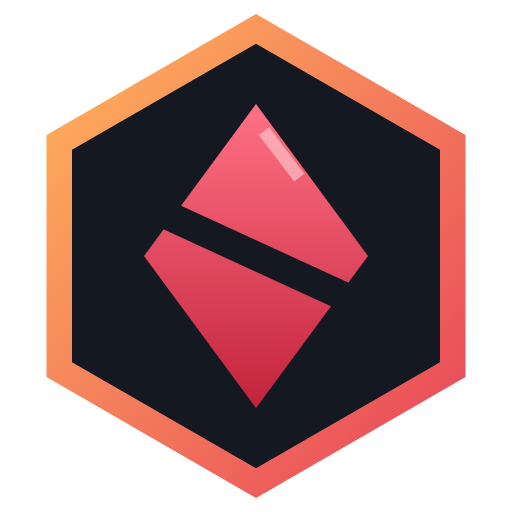
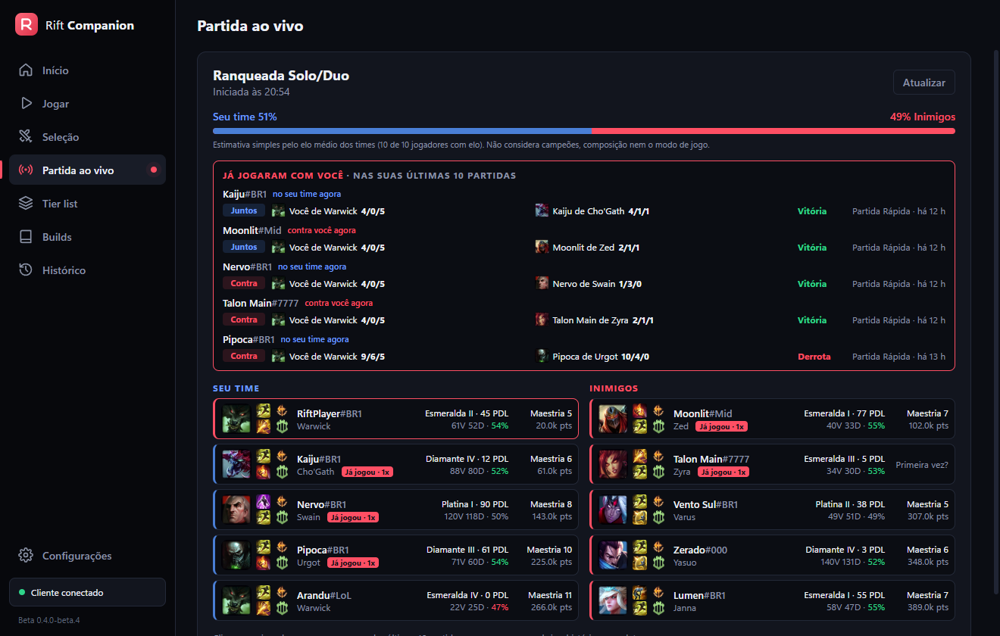
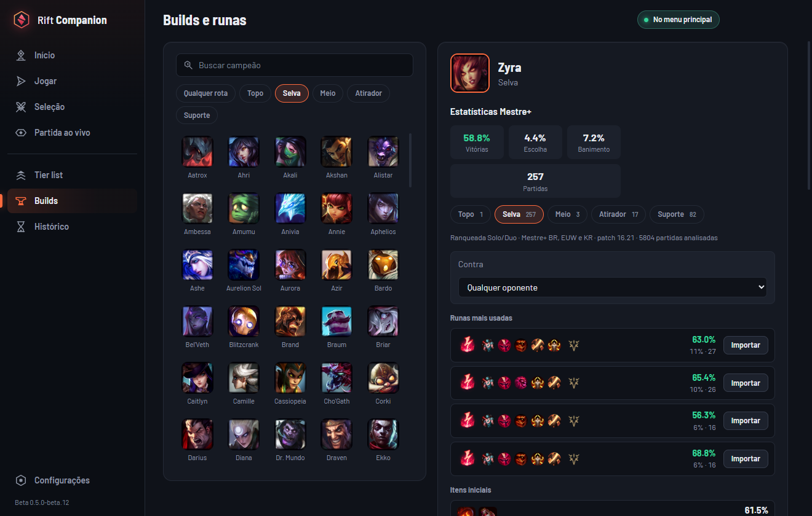
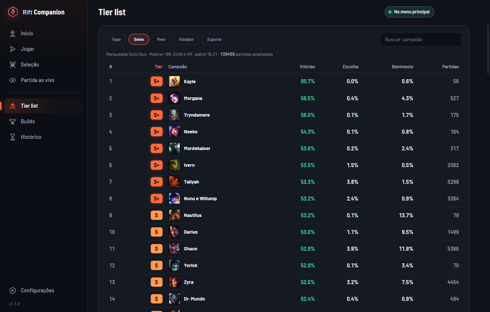

<p align="center">
  <a href="README.md">Português</a> · <strong>English</strong> · <a href="README.es.md">Español</a>
</p>

<p align="center">
  
</p>

<h1 align="center">Rift Companion</h1>

<p align="center">
  <strong>The free League of Legends companion that plays along with you.</strong><br />
  The right build for every match, runes and items in one click, a full scan of all 10 players
  and your whole client controlled from Telegram.
</p>

<p align="center">
  
  
  
  
  
</p>

<p align="center">
  <a href="https://rift-api.workscanner.com.br/downloads/RiftCompanion.exe"></a>
  &nbsp;
  <a href="https://matheusmunhoz99.github.io/rift-companion/"></a>
</p>

<p align="center">
  
</p>

<p align="center"><sub>The app interface is in Portuguese for now.</sub></p>

<table>
  <tr>
    <td width="33%" valign="top">
      <h3>A build for this match</h3>
      Detects your lane opponent and whether the enemy team deals mostly magic or physical damage, then shows the right items for <em>that</em> game.
    </td>
    <td width="33%" valign="top">
      <h3>Telegram control</h3>
      Queue up, accept the match, ban and pick champions, swap in ARAM and import runes from your phone.
    </td>
    <td width="33%" valign="top">
      <h3>Live game scan</h3>
      Rank, mastery and recent form of all 10 players, win estimate, and who played with or against you before.
    </td>
  </tr>
  <tr>
    <td valign="top">
      <h3>One-click runes and items</h3>
      Imports rune pages, summoner spells and item sets straight into the client.
    </td>
    <td valign="top">
      <h3>Master+ tier list</h3>
      The strongest champions in every role on the current patch, from tens of thousands of high-elo games.
    </td>
    <td valign="top">
      <h3>Safe for your account</h3>
      No injection, no memory reading and no hidden information. Official Riot APIs only.
    </td>
  </tr>
</table>

---

## A build for every match

A generic build ignores what matters most: **who you're playing against**. During champion select and the live game, Rift Companion:

- works out your **lane opponent** by finding each enemy's most likely role from high-elo data;
- reads the **enemy team's damage profile**: mostly magic, mostly physical or mixed;
- shows the **matchup build** and the **items Master+ players of your champion buy more often** against that kind of team;
- infers **your own role** from your team when the game doesn't provide it.

<p align="center">
  
</p>

All stats come from Ranked Solo/Duo games of **Master, Grandmaster and Challenger** players in **BR, EUW and KR**, always on the **current patch**: runes, spells, starting items, core items in purchase order, boots, skill order and matchups.

## Your League client on Telegram

Connect once and control the client from your phone, anywhere in the house. It's **a single panel** that updates itself as the game goes on, so your chat doesn't fill up with messages.

| When | What you can do from Telegram |
| --- | --- |
| **Client closed** | Open League (and close it, with confirmation) |
| **Main menu** | Pick a queue, turn auto-accept on or off |
| **Lobby** | Roles, both Swiftplay champions (shows the saved ones), invite friends, leave, find a match |
| **Queue** | See the estimated time and cancel |
| **Match found** | **Accept or decline** (your phone rings) |
| **Champion select** | **Ban and pick** with a button or by typing any champion's name |
| **ARAM** | See your rolled champion's art, **swap with the bench** and **reroll** |
| **Champion locked** | Import **Master+ runes** and **summoner spells** with one tap |
| **In game** | A notice at **0:00**, when champions spawn at the Nexus, plus KDA, CS and level |
| **Game over** | Win or loss with KDA, CS and duration, and **Play again** |

Only the important moments ring your phone: match found, your turn in champion select, game start and result. Everything else is the same panel being edited.

**How to connect:** in the app, go to **Configurações → Avisos no Telegram → Conectar Telegram** and tap **Start** in the bot. The app remembers the connection, even after you close and reopen it. Send `/painel` at any time to bring the panel back.

**Private by design:** each connected PC gets its own code, tied to your chat. Your messages and buttons never reach anyone else, and nobody but you can control your client.

## Live game scan

- Both teams **as soon as the game loads**, straight from the game. Rank, mastery and win estimate fill in when Riot makes the match available.
- Rank, win rate, mastery and last 10 games for each player. Click a name to open their full match history.
- **"Played with you"**: who was in your last 10 matches, on your team or against you, with both champions and KDAs.
- **Your build for this match**, already set for your opponent and the enemy damage profile.

## Tier list and builds for every champion

<p align="center">
  
</p>

A tier list by role with win, pick and ban rates, and a build page for any champion in any role, against any opponent.

## Also included

- **Auto-accept** for ready checks.
- **Queue from the app:** create lobbies, pick roles (including Swiftplay champions and priority roles), invite friends.
- **Player lookup** by Riot ID: rank, mastery, matches with champions, KDA and items.
- **In-game overlay** (borderless mode): KDA, CS per minute, gold and dragon and baron timers.
- A **responsive** interface for any monitor, custom icons, system tray, start with Windows and **automatic updates**.

## Install

1. Download **[RiftCompanion.exe](https://rift-api.workscanner.com.br/downloads/RiftCompanion.exe)** (Windows 10 or 11, about 100 MB). This link always serves the latest version.
2. Run it. No installer needed.
3. Open League. The app connects and updates on its own.

> **Windows says "Windows protected your PC"?** That warning shows up for new apps that don't have a reputation with Microsoft yet. Click **More info → Run anyway**. The source code is all here.

## How it works

```
                         ┌──────────────────────────────┐
  Telegram  ◄──────────► │ rift-api (our server)         │ ◄──────► Riot API
  (your phone)           │ Riot key, bot, cache,          │
                         │ Master+ stats                  │
                         └──────────────▲───────────────┘
                                        │ HTTPS
                         ┌──────────────┴───────────────┐
                         │ Rift Companion (your PC)      │
                         │ Electron + Angular            │
                         └──────┬───────────────┬────────┘
                                │ Client API     │ Live Client Data API
                                ▼               ▼
                         League client       Game (read-only)
```

- **League Client API (LCU)** and **Live Client Data API**: local to your PC only.
- **Riot API** (account-v1, summoner-v4, league-v4, champion-mastery-v4, match-v5, spectator-v5): **only through our server**. The key is never shipped with the app.
- **Telegram bot**: the bot token also lives only on the server.

## Fair play

Rift Companion follows Riot's [developer policies](https://developer.riotgames.com/policies/general):

- **No injection, memory reading or game file changes.** The overlay is a separate window.
- **No hidden information:** no enemy jungle timers and nothing from the fog of war.
- **No gameplay automation:** only client conveniences you turn on (queue, champion select, runes).

## Privacy

No accounts, no passwords and no ads. The server stores only aggregated stats, a temporary cache and, if you connect Telegram, your chat ID. See [PRIVACY.md](PRIVACY.md).

## Development

Requirements: Node.js 22+, Windows 10/11 and the League of Legends client.

```bash
npm install
npm --prefix renderer install
npm start
```

| Command | What it does |
| --- | --- |
| `npm run build` | Builds the main process and the interface |
| `npm test` | Runs the tests |
| `npm run dist` | Creates the portable executable in `release/` |

Folders: `electron/` (main process, League client, Telegram, overlay), `renderer/` (Angular interface), `server/` (rift-api: Riot API proxy, Telegram bot and stats collector) and `docs/ARQUITETURA.md` (technical notes, in Portuguese).

Suggestions and bugs: [open an issue](https://github.com/matheusmunhoz99/rift-companion/issues).

## Legal

Rift Companion isn't endorsed by Riot Games and doesn't reflect the views or opinions of Riot Games or anyone officially involved in producing or managing Riot Games properties. Riot Games, and all associated properties are trademarks or registered trademarks of Riot Games, Inc.
