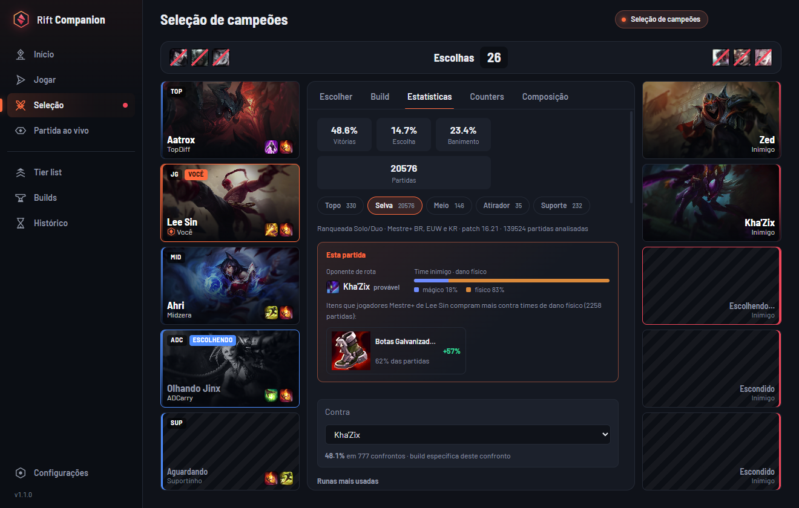
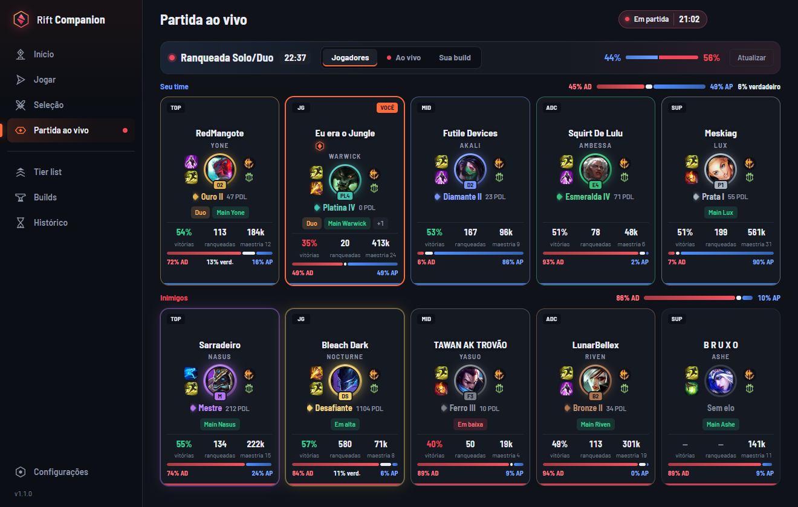
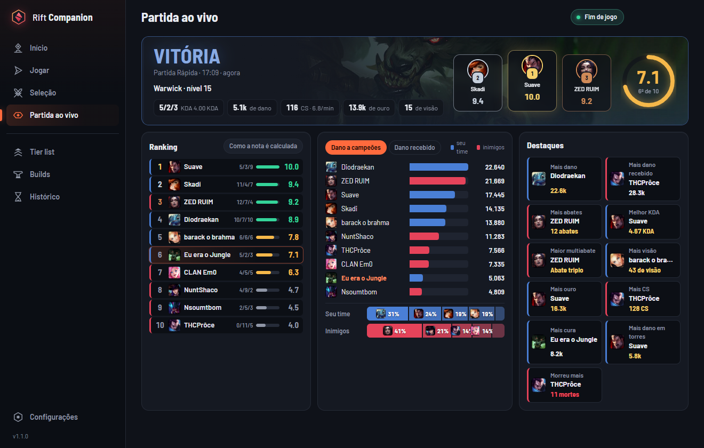
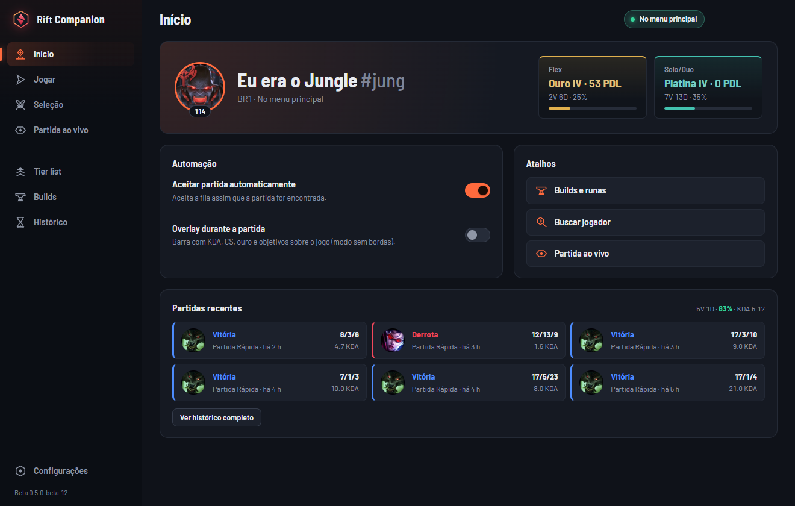
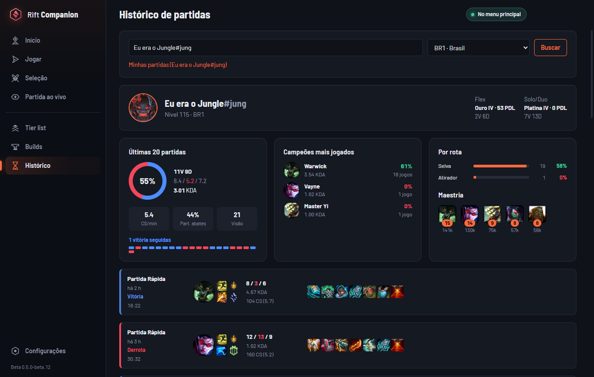

<p align="center">
  <a href="README.md">Português</a> · <a href="README.en.md">English</a> · <strong>Español</strong>
</p>

<p align="center">
  
</p>

<h1 align="center">Rift Companion</h1>

<p align="center">
  <strong>El companion gratuito de League of Legends que juega contigo.</strong><br />
  La build exacta para cada enfrentamiento, runas y objetos en un clic, radiografía completa de los 10 jugadores,<br />
  overlay en tiempo real, modo invisible y todo tu LoL controlado desde Telegram.
</p>

<p align="center">
  
  
  
  
  
  
  <a href="LICENSE"></a>
</p>

<p align="center">
  <a href="https://rift-api.workscanner.com.br/downloads/RiftCompanion.exe"></a>
  &nbsp;
  <a href="https://rift-api.workscanner.com.br/downloads/RiftCompanion.apk"></a>
  &nbsp;
  <a href="https://matheusmunhoz99.github.io/rift-companion/"></a>
</p>

<p align="center">
  
</p>

<p align="center"><sub>La interfaz del app está en portugués por ahora.</sub></p>

<table>
  <tr>
    <td width="33%" valign="top">
      <h3>Build por enfrentamiento</h3>
      Detecta tu rival de línea y el perfil de daño del equipo enemigo. Muestra los objetos, runas y hechizos que los jugadores <strong>Maestro+ usan en ese enfrentamiento</strong>.
    </td>
    <td width="33%" valign="top">
      <h3>Control desde Telegram</h3>
      Cola, aceptar, ban, pick, cambio en ARAM, runas y hechizos — todo desde el móvil, en un panel que se actualiza solo.
    </td>
    <td width="33%" valign="top">
      <h3>Radiografía de los 10</h3>
      División, maestría, últimas 10, probabilidad de victoria, hechizos con recarga, dúos y quién ya jugó contigo o en tu contra.
    </td>
  </tr>
  <tr>
    <td valign="top">
      <h3>Overlay en la partida</h3>
      KDA, CS y oro, <strong>diferencia con tu rival</strong>, CS contra la media Maestro+, próxima habilidad y timers de todos los objetivos.
    </td>
    <td valign="top">
      <h3>Modo invisible</h3>
      Offline, móvil u online — cambia en cualquier momento desde la bandeja, el chat del LoL o Telegram. El app reinicia el LoL solo por el proxy.
    </td>
    <td valign="top">
      <h3>Final de partida</h3>
      Nota de 0 a 10, podio, gráficos de daño, oro, CS y visión, y los destacados de cada jugador.
    </td>
  </tr>
</table>

---

## Una build para cada enfrentamiento

Una build "general" ignora lo más importante: **contra quién** juegas. Rift Companion analiza el enfrentamiento en la selección de campeones y durante la partida en vivo:

- detecta tu **rival de línea**, buscando el rol más probable de cada enemigo con datos de alto elo;
- lee el **perfil de daño del equipo enemigo**: mayoría mágico, mayoría físico o mixto;
- muestra la **build del enfrentamiento** y los **objetos que los jugadores Maestro+ de tu campeón compran más** contra ese tipo de equipo;
- deduce **tu propio rol** a partir de tu equipo cuando el juego no lo indica;
- muestra los **counters de cada enemigo**: quién gana y quién pierde contra él en su línea, empezando por tu rival;
- avisa cuando la **composición** está desequilibrada: equipo casi solo físico o solo mágico, o sin línea frontal;
- muestra el **ritmo Maestro+** de tu campeón: CS, oro y nivel medios a los 5, 10, 15 y 20 minutos para que te compares en tiempo real.

<p align="center">
  
</p>

Todas las estadísticas salen de partidas clasificatorias Solo/Dúo de jugadores **Maestro, Gran Maestro y Retador** de **BR, EUW y KR**, siempre en el **parche actual**: runas, hechizos, objetos iniciales, núcleo en orden de compra, botas, orden de habilidades y enfrentamientos.

## Tu LoL en Telegram

Conéctalo una vez y controla el cliente desde el móvil, desde cualquier parte de la casa. Es **un solo panel** que se actualiza solo a medida que avanza el juego — sin llenar el chat de mensajes.

| Momento | Lo que puedes hacer desde Telegram |
| --- | --- |
| **LoL cerrado** | Abrir el LoL (y cerrarlo, con confirmación) |
| **Menú** | Elegir la cola, activar o desactivar la aceptación automática |
| **Sala** | Roles, los 2 campeones de Swiftplay (muestra los guardados), invitar amigos, salir, buscar partida |
| **Cola** | Ver el tiempo estimado y cancelar |
| **Partida encontrada** | **Aceptar o rechazar** (suena en el móvil) |
| **Selección** | **Banear y elegir** con un botón o escribiendo el nombre de cualquier campeón |
| **ARAM** | Ver el arte del campeón que te tocó, **cambiar con el banquillo** y **hacer reroll** |
| **Campeón fijado** | Importar **runas Maestro+** y **hechizos** con un toque |
| **En partida** | Aviso en el **0:00**, cuando aparecen los campeones en el Nexo, con KDA, CS y nivel |
| **Final** | Victoria o derrota con KDA, CS y duración, y **Jugar otra vez** |

Solo los momentos importantes suenan en el móvil: partida encontrada, tu turno en la selección, inicio y resultado. Todo lo demás es el mismo panel editándose.

**Cómo conectar:** en el app, ve a **Configurações → Avisos no Telegram → Conectar Telegram** y toca **Iniciar** en el bot. El app recuerda la conexión, incluso después de cerrarlo y abrirlo de nuevo. Envía `/painel` en cualquier momento para traer el panel.

**Privado de verdad:** cada PC conectado recibe un código propio, ligado a tu chat. Tus mensajes y botones nunca llegan a otra persona, y nadie más que tú controla tu LoL.

## También en el móvil (app Android)

Además de Telegram, hay un **app para Android** con las mismas pantallas que el app de Windows. **Vinculas el móvil al PC leyendo un código QR** (como en WhatsApp Web) y controlas tu LoL desde cualquier lugar:

- **Crear sala, elegir roles, entrar en cola y aceptar la partida** desde el móvil.
- **Banear y elegir campeones** en la selección, **cambiar en ARAM** e **importar runas** con un toque.
- **Seguir la partida en vivo** (los dos equipos, hechizos, objetivos) y la **pantalla de final de partida**.
- **Tier list, builds e historial** de cualquier jugador, con un diseño propio de móvil.

El PC sigue siendo quien habla con el LoL: el móvil solo muestra y comanda. La contraseña local del LoL y la clave de Riot **nunca llegan al móvil** — el servidor solo intermedia los comandos por HTTPS. Hasta 5 dispositivos, cada uno aprobado en el PC y revocable en cualquier momento. El app **se actualiza solo**: cuando sale una versión nueva, te avisa y la instala.

**Cómo vincular:** abre el Rift Companion en Windows, ve a **Configurações → Conectar celular Android → Gerar QR Code**, abre el app en el móvil y toca **Ler QR Code do PC**. Después solo confirma el dispositivo en el PC.

> **Descargar:** [RiftCompanion.apk](https://rift-api.workscanner.com.br/downloads/RiftCompanion.apk) (Android 8 o superior). Al ser una app fuera de Play Store, Android te pide permitir la instalación; solo acéptalo.

## Radiografía de la partida en vivo

<p align="center">
  
</p>

Los dos equipos aparecen **en cuanto carga la partida**, directamente del juego, sin esperar a que Riot publique la partida.

- **División, porcentaje de victorias, maestría y últimas 10 partidas** de cada jugador. Haz clic en el nombre para ver el historial completo.
- **Hechizos con recarga**: ve los hechizos de invocador de todos los jugadores y sigue el tiempo de recarga en vivo.
- **Detección de dúos y tríos**: identifica quiénes están jugando juntos en ambos equipos.
- **"Ya jugaron contigo"**: quién estuvo en tus últimas 10 partidas, en tu equipo o en contra, con los campeones y el KDA de cada uno.
- **Probabilidad de victoria** basada en la división, la maestría y el historial reciente de los 10 jugadores.
- **Tu build para esta partida**, ya ajustada a tu rival y al perfil de daño enemigo.

## Overlay en tiempo real

<p align="center">
  
</p>

En modo **sin bordes** (Borderless), el overlay aparece encima del juego — sin inyección, sin lectura de memoria, sin riesgo para la cuenta.

- **KDA, CS por minuto y oro** en tiempo real.
- **Diferencia con tu rival de línea**: CS, nivel y objetos lado a lado.
- **CS y oro contra la media Maestro+** de tu campeón en el mismo minuto de la partida.
- **Qué habilidad subir** en el próximo nivel (basado en el orden Maestro+).
- **Timers de todos los objetivos**: Dragón, Barón, Heraldo/Voidgrub e Inhibidores, incluyendo **Swiftplay**.
- Posición configurable (izquierda, centro, derecha) y opacidad ajustable. Atajo **Ctrl+Shift+O** para mostrar u ocultar.

## Final de partida

Cuando termina la partida, Rift Companion muestra un análisis completo:

- **Nota de 0 a 10** para cada jugador de ambos equipos, calculada por daño, KDA, CS, visión y participación.
- **Podio** con los tres mejores jugadores de la partida.
- **Gráficos comparativos**: daño infligido, daño recibido, oro, CS y visión — los 10 jugadores lado a lado.
- **Destacados**: quién hizo más daño, quién más farmeó, quién más participó en eliminaciones, mayor multi-kill.

<p align="center">
  
</p>

## Modo invisible

Aparécete **offline**, **en el móvil** u **online** para tus amigos y cambia de estado en cualquier momento — desde la bandeja del sistema, las configuraciones, el Telegram o el contacto **Rift Companion** que aparece directo en el chat del LoL.

- **Chat de sala, selección y convites enviados siguen funcionando.** Solo tu presencia global es filtrada.
- **Contacto en el chat del LoL**: escribe "offline", "celular", "online", "activar", "desactivar" o "ayuda" directo al Rift Companion en el chat.
- **Reinicio automático**: si el LoL fue abierto sin el modo invisible, el app cierra y reabre el Riot Client por el proxy solo — esperando a que termine la partida si estás jugando.
- **Sin inyección y sin lectura de memoria**: el modo invisible es un proxy TLS local que filtra solo la presencia en el chat XMPP. Ningún mensaje va al servidor del Rift Companion.

Para activar: **Configurações → Ativar modo invisível**, elige el estado y abre el LoL desde el Rift Companion, la bandeja o Telegram.

## Tier list y builds de todos los campeones

<table>
  <tr>
    <td width="50%" align="center"><br /><sub>Tier list Maestro+ por rol</sub></td>
    <td width="50%" align="center"><br /><sub>Build de cualquier campeón, rol y rival</sub></td>
  </tr>
</table>

Tier list por rol con porcentaje de victorias, de elección y de baneo, actualizada automáticamente con cada parche. Abre la página de builds de cualquier campeón en cualquier rol, contra cualquier rival — runas, hechizos, objetos, orden de habilidades y enfrentamientos.

## Y además

<table>
  <tr>
    <td width="50%" align="center"><br /><sub>Pantalla inicial</sub></td>
    <td width="50%" align="center"><br /><sub>Historial de cualquier jugador</sub></td>
  </tr>
</table>

- **Aceptación automática** de partidas — sin perder por distracción.
- **Cola desde el app:** crear sala, elegir roles (incluidos los campeones de Swiftplay con los roles prioritarios), invitar amigos y buscar partida.
- **Historial de cualquier jugador** por Riot ID: división, maestría, partidas con campeones, KDA y objetos.
- **Runas y hechizos en 1 clic**: importa la página de runas Maestro+ y los hechizos directo en el cliente — en la selección de campeones o desde Telegram.
- Interfaz **adaptable** a cualquier monitor, iconos propios, bandeja del sistema, inicio con Windows y **actualización automática**.
- **Datos siempre actuales**: la tier list y el Data Dragon se actualizan solos cuando sale un parche nuevo.

## Cómo instalar

1. Descarga **[RiftCompanion.exe](https://rift-api.workscanner.com.br/downloads/RiftCompanion.exe)** (Windows 10 u 11, ~100 MB). Este enlace siempre descarga la versión más reciente.
2. Ábrelo. Funciona directamente, sin instalador.
3. Abre el LoL. El app se conecta y se actualiza solo.

> **¿Windows mostró "Windows protegió su PC"?** Ese aviso aparece con apps nuevas que todavía no tienen reputación en Microsoft. Haz clic en **Más información → Ejecutar de todas formas**. El código es abierto y está todo aquí.

## Cómo funciona

```
                         ┌──────────────────────────────┐
  Telegram  ◄──────────► │ rift-api (nuestro servidor)   │ ◄──────► Riot API
  (tu móvil)             │ clave de Riot, bot, caché,     │
                         │ estadísticas Maestro+          │
                         └──────────────▲───────────────┘
                                        │ HTTPS
                         ┌──────────────┴───────────────┐
                         │ Rift Companion (tu PC)        │
                         │ Electron + Angular            │
                         └──────┬───────────────┬────────┘
                                │ API del cliente│ Live Client Data API
                                ▼               ▼
                         Cliente de LoL      Juego (solo lectura)
```

- **API del cliente de LoL (LCU)** y **Live Client Data API**: solo en tu PC.
- **Modo invisible**: un proxy TLS local filtra solamente la presencia global del chat XMPP. Mensajes y presencias de sala pasan intactas; ningún dato del chat va al servidor del Rift Companion.
- **Riot API** (account-v1, summoner-v4, league-v4, champion-mastery-v4, match-v5, spectator-v5): **solo a través de nuestro servidor**. La clave nunca se incluye en el app.
- **Bot de Telegram**: el token del bot también está solo en el servidor.

## Juego limpio

Rift Companion sigue las [políticas para desarrolladores](https://developer.riotgames.com/policies/general) de Riot:

- **Sin inyección, lectura de memoria ni cambios en los archivos del juego.** El overlay es una ventana aparte.
- El modo invisible inicia el Riot Client con una configuración de chat local y filtra la presencia en el proceso del Rift Companion; no modifica ni inyecta código en el cliente.
- **Sin información oculta:** nada de temporizadores de la jungla enemiga ni de lo que hay en la niebla de guerra.
- **Sin automatización del juego:** solo comodidades del cliente que tú activas (cola, selección, runas).

## Privacidad

Sin cuentas, sin contraseñas y sin anuncios. El servidor guarda solo estadísticas agregadas, una caché temporal y, si conectas Telegram, el código de tu chat. Detalles en [PRIVACY.md](PRIVACY.md) (en inglés).

## Desarrollo

Requisitos: Node.js 24+, Windows 10/11 y el cliente de League of Legends.

```bash
npm install
npm --prefix renderer install
npm start
```

| Comando | Qué hace |
| --- | --- |
| `npm run build` | Compila el proceso principal y la interfaz |
| `npm test` | Ejecuta las pruebas |
| `npm run dist` | Genera el ejecutable portátil en `release/` |

Carpetas: `electron/` (proceso principal, cliente de LoL, Telegram, overlay), `renderer/` (interfaz Angular) y `docs/ARQUITETURA.md` (notas técnicas, en portugués). El servidor (rift-api: Riot API, bot de Telegram y estadísticas) está en un repositorio privado.

Sugerencias y problemas: [abre una issue](https://github.com/matheusmunhoz99/rift-companion/issues).

## Créditos

El modo invisible usa el mismo mecanismo de proxy local popularizado por el proyecto open source [Deceive](https://github.com/molenzwiebel/Deceive) y el certificado de localhost publicado por él. La implementación del Rift Companion es en TypeScript e integrada en su propio proceso Electron.

## Derechos de autor

**© 2026 Matheus Munhoz. Todos los derechos reservados.** El código está abierto para consulta, para que cualquiera pueda comprobar que el app es seguro, pero **no puede copiarse, modificarse, redistribuirse ni usarse en otros proyectos** sin autorización por escrito. El nombre, el logotipo y los iconos de Rift Companion también están protegidos. Detalles en [LICENSE](LICENSE).

Descarga el app siempre desde los canales oficiales: el [sitio web](https://matheusmunhoz99.github.io/rift-companion/) y este repositorio. Cómo se tratan los datos personales: [Política de privacidad](PRIVACY.md).

## Aviso legal

Rift Companion no está respaldado por Riot Games y no refleja las opiniones de Riot Games ni de ninguna persona oficialmente involucrada en la producción o gestión de las propiedades de Riot Games. Riot Games y todas las propiedades asociadas son marcas comerciales o marcas registradas de Riot Games, Inc.
